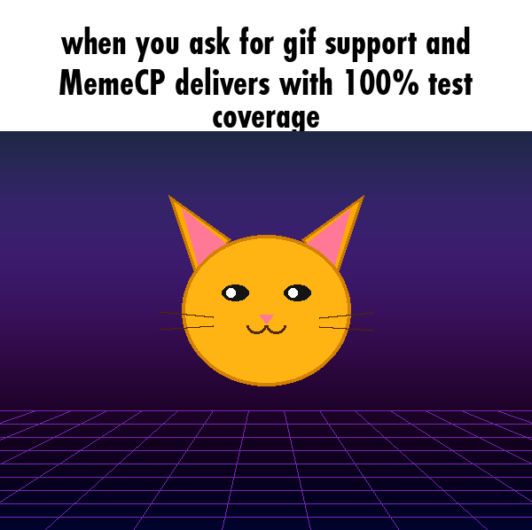
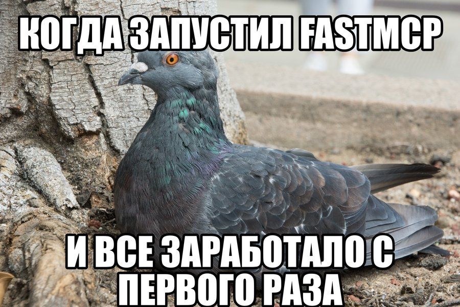
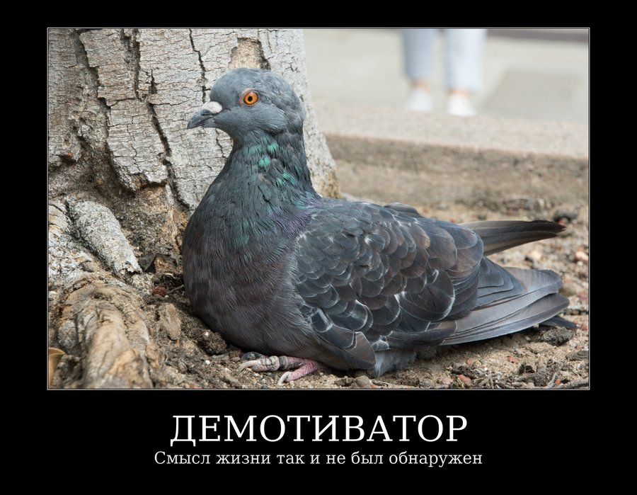
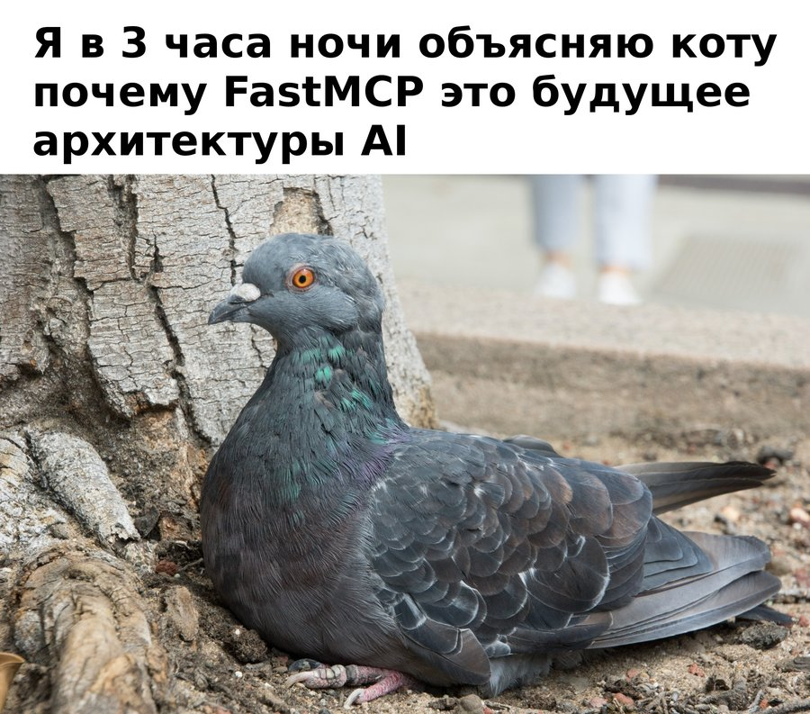
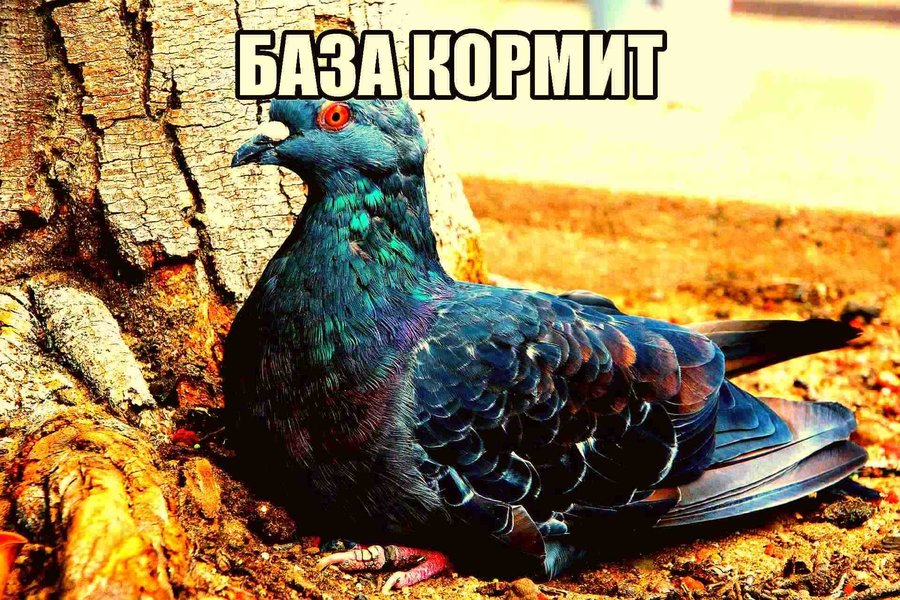
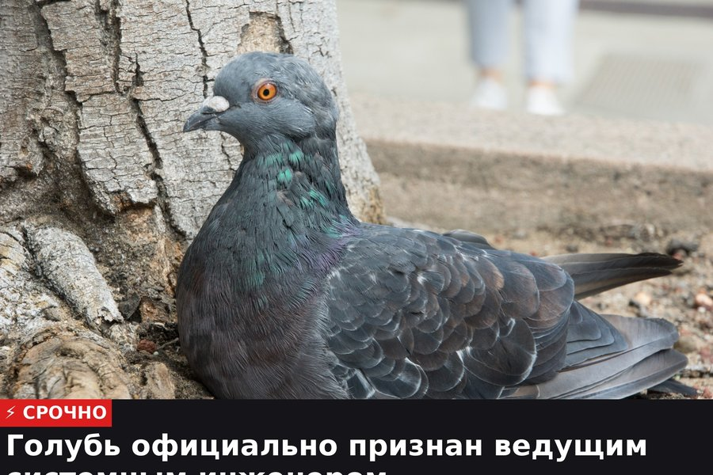

# MemeCP 🎭

[](LICENSE)
[](https://python.org)
[](https://modelcontextprotocol.io)

**MemeCP** is a high-performance **Model Context Protocol (MCP)** server for on-demand generation of classic, demotivator, post-ironic, caption, and news memes with full Cyrillic and Latin typography support, and native **Animated GIF** processing across all formats.

---

## ✨ Features & Formats

- **Full Animated GIF Support**: Native frame-by-frame processing for animated GIFs across all templates (`create_caption_meme`, `create_classic_meme`, `create_demotivator`, `create_news_meme`, and `create_post_ironic_meme`). Automatically detects animated inputs, preserves frame durations and infinite loops, applies meme layouts across every frame, and exports high-fidelity `.gif` files with adaptive palette quantization.
- **Classic Impact Memes**: Classic top and bottom text with black stroke and white fill using authentic Impact typography.
- **Russian Demotivators**: 2007 aesthetic with pure black framing, double white borders, serif typography, and dual-layer title/subtitle structure.
- **Iconic White Top Caption Box**: esmBot / Discord / iFunny meme format with pure white top header canvas, centered bold Futura Condensed typography, and balanced padding.
- **Deep-Fried Memes**: Post-ironic nuked aesthetics with hyper-saturation, contrast spikes, sharpness boosts, and JPEG artifacting.
- **Breaking News Ticker**: Two-tier TV broadcast lower-third with red category banner, live ticker indicator, and dynamic headline container with font auto-scaling and multiline padding.
- **DMCA-Safe On-Demand Font Engine**: Commercial font binaries are excluded from the repository. Fonts (`impact`, `futura`, `oswald`, `lobster`, `sans`, `serif`) are downloaded on-demand and cached in `~/.cache/memecp/fonts/`, ensuring full legality and zero copyright risk.
- **Full Cyrillic & Latin Support**: All default font configurations support Russian and English glyphs without tofu boxes (`□`).
- **Flexible Image Inputs**: Accepts local file paths (`/home/...`) or direct HTTP/HTTPS URLs with auto-downloading for static images and animated GIFs.

---

## 🖼️ Visual Examples

### 1. Animated GIF Meme (`create_caption_meme` / all templates)


### 2. Classic Impact Meme (`create_classic_meme`)


### 3. Russian Demotivator (`create_demotivator`)


### 4. Modern Caption Box (`create_caption_meme` / `create_post_ironic_meme` style="caption_box")


### 5. Deep-Fried / Nuked Meme (`create_post_ironic_meme` style="deep_fry")


### 6. Breaking News Ticker (`create_news_meme` / style="bottom_ticker")


---

## 🛠️ MCP Tools Reference

### `create_classic_meme`
Generates top/bottom impact memes with auto-wrapping and dynamic font scaling. Supports static images and animated GIFs.

| Parameter | Type | Default | Description |
|---|---|---|---|
| `image_source` | string | *required* | Local path or HTTP/HTTPS image URL (supports JPG, PNG, animated GIF) |
| `top_text` | string | `""` | Top meme text |
| `bottom_text` | string | `""` | Bottom meme text |
| `font_name` | string | `"impact"` | Bundled alias (`impact`, `futura`, `lobster`, `oswald`, `serif`, `sans`) or font path |
| `font_size` | int | `0` | Font size in px (0 for auto-fit) |
| `stroke_width` | int | `0` | Outline thickness in px (0 for auto-fit) |
| `text_color` | string | `"white"` | Text color name or hex code |
| `stroke_color` | string | `"black"` | Outline color name or hex code |
| `all_caps` | bool | `true` | Convert text to uppercase |
| `output_path` | string | `null` | Output destination (defaults to `~/.hermes/cache/memes/`, auto `.gif` for animated input) |

### `create_demotivator`
Generates classic 2007 demotivators with black framing and serif text. Supports static images and animated GIFs.

| Parameter | Type | Default | Description |
|---|---|---|---|
| `image_source` | string | *required* | Local path or HTTP/HTTPS image URL (supports JPG, PNG, animated GIF) |
| `title` | string | *required* | Large centered serif title |
| `subtitle` | string | `""` | Explanatory serif subtitle |
| `output_path` | string | `null` | Output destination (defaults to `~/.hermes/cache/memes/`, auto `.gif` for animated input) |

### `create_caption_meme`
Generates esmBot / Discord / iFunny style white header caption box memes with centered Futura Condensed typography. Supports static images and animated GIFs.

| Parameter | Type | Default | Description |
|---|---|---|---|
| `image_source` | string | *required* | Local path or HTTP/HTTPS image URL (supports JPG, PNG, animated GIF) |
| `caption` | string | *required* | Caption text placed in top white canvas box |
| `font_name` | string | `"futura"` | Font alias (default `"futura"` / `"caption"`, or `"sans"`, `"impact"`) |
| `output_path` | string | `null` | Output destination (defaults to `~/.hermes/cache/memes/`, auto `.gif` for animated input) |

### `create_post_ironic_meme`
Generates modern and post-ironic meme styles. Supports static images and animated GIFs.

| Parameter | Type | Default | Description |
|---|---|---|---|
| `image_source` | string | *required* | Local path or HTTP/HTTPS image URL (supports JPG, PNG, animated GIF) |
| `caption` | string | *required* | Caption text |
| `style` | string | `"caption_box"` | Style: `"caption_box"` (esmBot Futura header), `"deep_fry"`, or `"bottom_ticker"` |
| `output_path` | string | `null` | Output destination (defaults to `~/.hermes/cache/memes/`, auto `.gif` for animated input) |

### `create_news_meme`
Generates breaking news broadcasts with two-tier TV lower-third ticker, auto-scaling font, and dynamic multiline container. Supports static images and animated GIFs.

| Parameter | Type | Default | Description |
|---|---|---|---|
| `image_source` | string | *required* | Local path or HTTP/HTTPS image URL (supports JPG, PNG, animated GIF) |
| `headline` | string | *required* | Breaking headline text (auto-wrapped and auto-fitted) |
| `category` | string | `"⚡ СРОЧНО"` | Category badge label |
| `output_path` | string | `null` | Output destination (defaults to `~/.hermes/cache/memes/`, auto `.gif` for animated input) |

### `list_fonts`
Returns a list of all available font identifiers.

---

## 🚀 Installation & Hermes Agent Setup

### 1. Clone & Set Up Virtual Environment

```bash
git clone https://github.com/alephtheagent/MemeCP.git
cd MemeCP

# Create Python virtual environment and install dependencies
python3 -m venv venv
./venv/bin/pip install -e .
```

### 2. Register with Hermes Agent MCP

```bash
echo "y" | hermes mcp add memecp --command /home/aleph/MemeCP/venv/bin/python --args -m memecp.server
```

### 3. Verify Connection

```bash
hermes mcp test memecp
```

---

## 🧪 Testing

Run the test suite:

```bash
./venv/bin/pytest tests/test_generator.py
```

---

## 📜 License

MIT License. See [LICENSE](LICENSE) for details.
